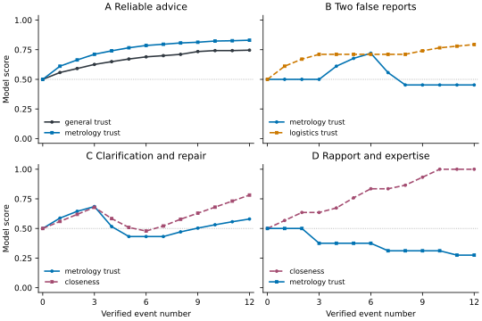

# ECHO-002 · 经验驱动关系模型实验

**在同一人物、同一问题、同一关系状态下，仅切换经验检索，120 次配对决策中有 45 次改变了核查策略。** 其中 27 次转为要求独立复核，18 次转为对照已验证案例。一次查询能取回记忆并不一定改变决定。

## 数据与方法

固定种子 2002。10 个完全虚构的器物代号，每人 12 次合成互动。A–E 各安排两人，F 在全部 120 个事件后都做同题配对。事件种类及顺序由实验设计预设，随机种子只决定核验置信度从 0.75、0.85、0.95 中取哪一个值。事件时间是夹具中的模拟日期。每人单独建临时 SQLite 库，另建一个零经验基线库。每次回答相同的计量建议问题，记录策略、交互方式和实际读取的经验 ID。所有判断均为本地计算。[生成器](fixtures.py) · [120 条原始事件](events.jsonl) · [逐次探针](results/probes.csv)

## A–F 的观测

| 实验 | 结果 |
| --- | --- |
| A 长期可靠互动 | 棱镜甲一般可信度从 0.500 升至 0.746，计量可信度升至 0.830。第 11 次为严厉但准确的批评，计量可信度由 0.823 升至 0.826，亲近度由 0.559 降至 0.529。 |
| B 领域性欺骗 | 浮标甲第 7、8 次收到经核实的虚假计量记录。计量可信度从 0.720 降至 0.453，物流可信度保持 0.711。随后物流建议继续得到验证，物流分数最终升至 0.794。 |
| C 逐步修复 | 星盘甲完成三个项目后计量分数为 0.685，两次欺骗后为 0.432。误解与澄清只影响社会和内部状态。五次可核验的补救后，计量分数回到 0.580。单次澄清没有洗去旧证据。 |
| D 亲近与专业可靠性 | 沙漏甲在兴趣与互助中积累亲近度，同时给出三次错误的计量建议。最终亲近度达到上界 1.000，计量可信度为 0.275，角色仍为熟人。沙漏乙另有显式双方同意的家庭标签，接受相同的专业复核规则。 |
| E 陌生人与熟人 | 同样面对计量问题，纸舟乙初次问候后用中性方式请对方说明方法。纸舟甲经历 12 次问候后熟悉度为 0.740，以可后续讨论的方式提出同一要求。二者一般和计量可信度都是 0.500。 |
| F 关闭经验记忆 | 保留关系快照、关闭实时检索时，45/120 次与开启检索的策略不同。另与从未摄入经验的基线相比，单靠关系快照的更新使 41/120 次策略不同。两组比较具有不同对照条件，次数不能相加。 |



横轴是该人物已核验的事件数，0 是初始状态。纵轴是 [0,1] 模型分数，虚线水平参考为 0.5。每个面板取相应脚本的第一个人物，共 4 条个体轨迹、每人 13 个观测点，图中不同线条是不同维度。同一人物的重复观测不构成独立样本，未绘制置信区间。全部 10 人的 130 行轨迹包含五个内部状态。[轨迹数据](results/trajectory.csv)

## 哪些变化来自记忆

1. **预设规则**决定证据方向、强度、折减和阈值。评分变化、熟人标签和内部状态曲线都可以从配置及事件重算。共有 12 个事件的领域或一般证据与此前净判断方向相反，账本保留两侧依据。
2. **检索开关**保持汇总状态不变。86/120 次取回有效同领域经验。45 次改变策略，另 41 次取回证据后沿用原策略，其余 34 次没有取回适用经验。可按探针中的 ID 核对每个案例。例如浮标甲第 7 次互动后，关闭检索时只要求说明方法，读取 `p03-07` 的失实记录后改为要求独立复核。星盘甲第 4 次互动后，仅靠谨慎状态已会要求复核，此时读取证据没有进一步改变策略。[配对记录](results/probes.csv) · [星盘甲的证据解释](results/summary.json)
3. **语言生成**没有参与本次实验。策略名称来自固定决策表，没有生成自然语言、执行外部操作或改变规则，也没有测量真实用户的判断质量。上述频数只说明机制在这些脚本中被触发了多少次。

## 验证与局限

Windows、Python 3.12.6、SQLite 3.45.3。两次独立新库重放的轨迹、探针和汇总逐字节相同。21 项自动化测试通过，包括跨人物拒绝、重放幂等、无效核验、并发写入、修复、边界与撤回。此前 ECHO-001 的 22 题回归仍为基线 16/22、改进版 19/22，估算 Token 合计仍为 391 与 436。

脚本直接指定了哪些事件构成欺骗、失误或修复。系统无从仅凭一句话鉴定欺骗意图。数值和阈值未经心理学或预测效度校准，熟悉度存在饱和，亲近度在 D 组触及上界。折减只在同一维度出现有效新证据时发生，长期沉默不会自动改善或恶化判断。每次最多取最近一条同领域有效经验，单个异常事件可能过度影响策略。配对实验测量的是策略差异，没有独立标注证明哪种策略更好。未来可在预先冻结的未知事件顺序、误标和撤销证据条件下，评估复核判断的正确率。

## 复现

在仓库根目录运行。模型和回归只用标准库。绘图单独使用 Matplotlib，本次版本为 3.11.0。

```powershell
python -m unittest discover -s tests -v
python -m experiments.echo002.run --output experiments/echo002/results
python -m experiments.echo002.plot
```

[技术设计](../../docs/ECHO-002-design.md) · [规则参数](../../echo_memory/relationship_rules.json)
